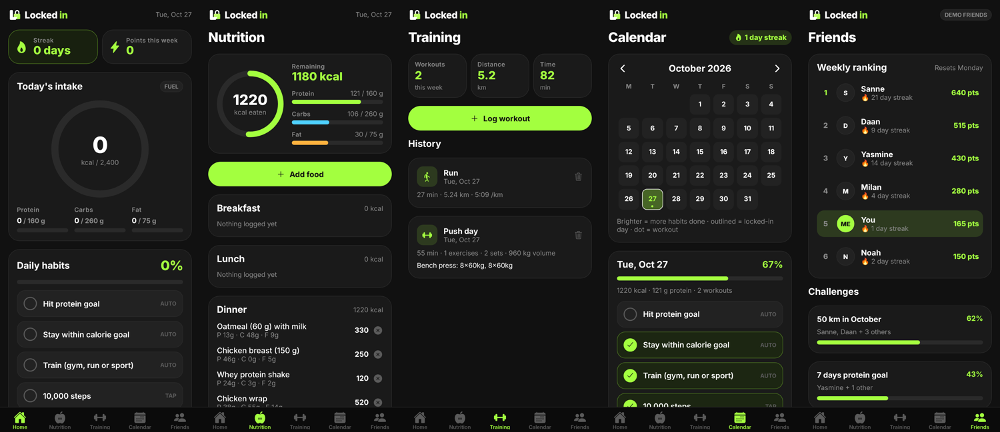

# Locked in

**LOCK IN. LEVEL UP.**

Locked in is an all-in-one fitness, nutrition and lifestyle app. It tracks food, workouts and daily habits, adds streaks and points, and lets you compete with friends.



This repository holds **stage 1 (MVP)**: a working iPhone and Android app with all five tabs. Your data is saved on your phone. The [roadmap](docs/ROADMAP.md) explains how we get from here to the App Store and Google Play.

---

## What works right now

| Tab | What you can do |
|---|---|
| **Home** | Today's calorie ring, macros, daily habits %, streak, weekly points, today's training and achievements |
| **Nutrition** | Add food by hand or from a quick-add list, grouped into Breakfast, Lunch, Dinner and Snacks. Calories left and progress bars for protein, carbs and fat |
| **Training** | Log gym sessions (exercises, sets, reps, kg), runs (distance and time, with automatic pace) and other sports. Weekly totals and history |
| **Calendar** | Month view: a brighter day means more habits done, an outline marks a "locked-in" day, a dot marks a workout. Tap any day to see or edit it |
| **Friends** | Weekly ranking (you against demo friends), challenges, a feed with likes, and an "Invite friends" share button |

**How habits and points work** (all in `src/store/logic.ts`, easy to change):

- **Auto habits** tick themselves: protein goal reached, calories logged and within goal, and a workout logged.
- **Manual habits** are ticked by tapping: 10,000 steps, 3 L water, asleep by 23:00.
- A day is **locked in** at ≥ 60% of habits done. Consecutive locked-in days form your **streak**.
- **Points:** 10 per habit, 50 per workout, and +25 for a locked-in day.

**Not yet** (placeholders show "SOON" or "DEMO"): AI food photo, barcode scanner, Garmin sync, real friends and accounts. Each one is a later stage in the roadmap.

---

## Run it on your own phone (no coding experience needed)

You need a computer (Windows or Mac) and your phone, on the same Wi-Fi.

1. **Install Node.js** (the engine that runs the tools). Download the LTS version from <https://nodejs.org> and click through the installer.
2. **Install the Expo Go app** on your phone (App Store or Google Play).
3. **Download this project.** On GitHub, click the green **Code** button, then **Download ZIP**, and unzip it. If you have Git installed, you can run `git clone` instead.
4. **Open a terminal in the project folder.**
   - Windows: open the folder, click the address bar, type `cmd` and press Enter.
   - Mac: right-click the folder, then choose **New Terminal at Folder**.
5. **Install the project's libraries.** Do this once; it takes a few minutes:
   ```bash
   npm install
   ```
6. **Start the app:**
   ```bash
   npx expo start
   ```
   A QR code appears.
7. **Scan the QR code.** On iPhone, use the Camera app. On Android, use the scanner inside Expo Go. Locked in opens on your phone.

Every time you save a change in the code, the app on your phone updates within a second. To stop the app, press `Ctrl + C` in the terminal.

> Tip: install **Visual Studio Code** (<https://code.visualstudio.com>) to open and edit the project. It's free and is what most developers use.

---

## Where everything lives (project map)

```
src/
  app/                      ← every file here is a SCREEN
    _layout.tsx             ← app shell: dark theme + saved data
    (tabs)/_layout.tsx      ← the bottom tab bar (Home, Nutrition, …)
    (tabs)/index.tsx        ← Home dashboard
    (tabs)/nutrition.tsx    ← Nutrition tab
    (tabs)/training.tsx     ← Training tab
    (tabs)/calendar.tsx     ← Calendar tab
    (tabs)/friends.tsx      ← Friends tab
    add-food.tsx            ← "Add food" pop-up screen
    log-workout.tsx         ← "Log workout" pop-up screen
  components/               ← reusable building blocks
    Logo.tsx                ← the Locked in logo (drawn in code)
    ProgressRing.tsx        ← the animated calorie ring
    HabitList.tsx           ← the daily habit checklist
    ui.tsx                  ← cards, buttons, inputs, progress bars
  constants/theme.ts        ← ALL colors (Neon Lime #A3FF3F, Midnight Black #111111)
  store/
    store.tsx               ← saves and loads your data on the phone
    logic.ts                ← rules for habits, streaks, points and achievements
    types.ts                ← what a food entry, workout, etc. looks like
    dates.ts                ← date helpers
  data/
    foods.ts                ← quick-add food list
    friends.ts              ← demo friends, feed and challenges
assets/images/              ← app icon, splash screen, favicon
app.json                    ← app name, icon and IDs for the app stores
```

### Easy first changes to try

- **Change the brand color:** edit `lime` in `src/constants/theme.ts`.
- **Change your calorie or macro goals:** edit `goals` in `src/store/store.tsx` (`initialState`).
- **Add a habit:** add a line to `HABITS` in `src/store/logic.ts`, and its id to `HabitId` in `src/store/types.ts`.
- **Add quick-add foods:** add lines to `src/data/foods.ts`.

## Built with

- [Expo](https://expo.dev) and [React Native](https://reactnative.dev): one codebase for iPhone, Android and web
- [Expo Router](https://docs.expo.dev/router/introduction/) for screens and navigation
- TypeScript, react-native-svg (logo and rings) and AsyncStorage (saving data)

Useful commands:

```bash
npx expo start          # run the app (scan the QR code with your phone)
npx expo start --web    # run it in your browser
npx tsc --noEmit        # check the code for mistakes
```
